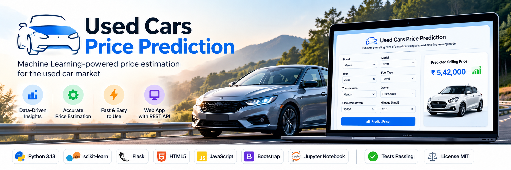
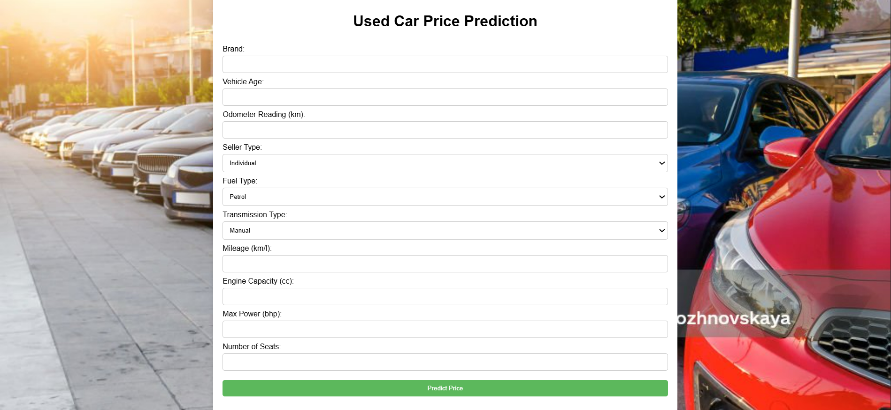
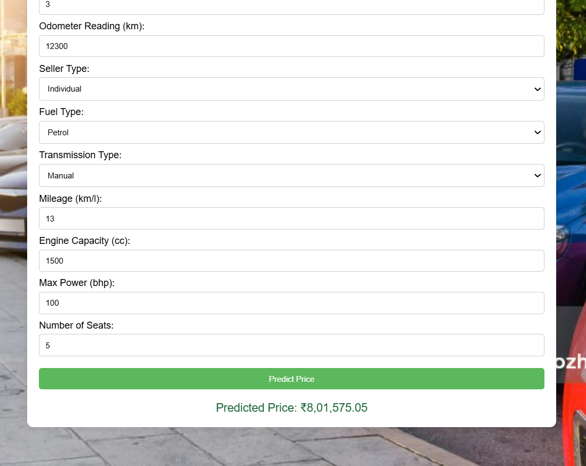

 <!-- Hero banner -->
<p align="center">
  
</p>

<h1 align="center">Used Cars Price Prediction</h1>

<p align="center">
  A machine learning-powered web application that estimates the selling price of used cars based on vehicle specifications and other relevant features.
</p>

<!-- GitHub Status Badges -->
<p align="center">
  
  
  
  
  
</p>

<!-- Technology Badges -->
<p align="center">
  
  
  
  
  
  
  
  
  
</p>

---

## Table of Contents

- [Application Preview](#application-preview)
- [Features](#features)
- [How It Works](#how-it-works)
- [Dataset](#dataset)
- [Machine Learning Model](#machine-learning-model)
- [Installation and Setup](#installation-and-setup)
- [Running the Application](#running-the-application)
- [API Documentation](#api-documentation)
- [Running Tests](#running-tests)
- [Project Structure](#project-structure)
- [Future Improvements](#future-improvements)
- [License](#license)

---

## Application Preview

<p align="center">
  
</p>

<p align="center">
  <em>Enter vehicle specifications to estimate its selling price.</em>
</p>

<p align="center">
  
</p>

<p align="center">
  <em>View the predicted selling price returned by the machine learning model.</em>
</p>

---

## Features

- **Used Car Price Prediction:** Estimate a car's selling price using its specifications.
- **Machine Learning Pipeline:** Uses a trained scikit-learn model saved with Joblib.
- **Web Interface:** Enter vehicle details through a simple HTML, CSS, and JavaScript interface.
- **REST API:** Flask backend provides prediction and health-check endpoints.
- **Input Validation:** Checks missing, invalid, and inappropriate input values.
- **Local Execution:** Run the frontend and backend locally without a separate frontend build process.

## How It Works

The application follows this workflow:

1. Enter the vehicle details in the web interface.
2. The frontend sends the information to the Flask prediction API.
3. The backend validates the submitted values.
4. The trained machine learning pipeline processes the input.
5. The API returns the estimated selling price.
6. The result is displayed in the web interface.

```text
Vehicle Details
      |
      v
Web Interface (HTML, CSS, JavaScript)
      |
      v
Flask REST API
      |
      v
Input Validation
      |
      v
Trained ML Pipeline
      |
      v
Predicted Selling Price
      |
      v
Display Result
```

---

## Dataset

This project uses the CarDekho used-car dataset.

The repository includes two dataset files:

| File | Description |
|---|---|
| `data/cardekho_dataset.csv` | Raw dataset |
| `data/cleaned_cardekho_dataset.csv` | Cleaned dataset |

The dataset contains vehicle information and selling prices. The training notebook uses features such as:

- Brand
- Vehicle age
- Kilometres driven
- Seller type
- Fuel type
- Transmission type
- Mileage
- Engine capacity
- Maximum power
- Number of seats

The target variable is `selling_price`.

## Machine Learning Model

The model is trained in:

`model/car_price_prediction_training.ipynb`

The notebook includes:

- Dataset loading and inspection
- Data preparation and preprocessing
- Feature and target separation
- Training and hyperparameter tuning using `GridSearchCV`
- Model evaluation
- Saving the trained model using Joblib

The trained model is stored at:

`model/car_price_prediction_model.pkl`

The Flask backend loads this saved model to generate predictions.

**Compatibility note:** The project currently specifies `scikit-learn==1.9.1` in `requirements.txt` to maintain compatibility with the saved model.


## Installation and Setup

### 1. Clone the repository

```bash
git clone https://github.com/AvinabhDutta-Dev/used-cars-price-prediction.git
cd used-cars-price-prediction
```

### 2. Create a virtual environment

Choose the commands for your operating system.

**Windows (PowerShell):**

```powershell
py -m venv .venv
.venv\Scripts\Activate.ps1
```

**Windows (Command Prompt):**

```cmd
py -m venv .venv
.venv\Scripts\activate.bat
```

**Linux and macOS (Bash/Zsh):**

```bash
python3 -m venv .venv
source .venv/bin/activate
```

### 3. Install dependencies

After activating the virtual environment, run:

```bash
python -m pip install --upgrade pip
python -m pip install -r requirements.txt
```


## Running the Application

### 1. Start the Flask backend

From the project root directory, run:

```bash
python server/server.py
```

The API will be available at:

`http://127.0.0.1:5000`

### 2. Open the frontend

Open the following file in your web browser:

`client/UCPPM.html`

### 3. Make a prediction

- Enter the required vehicle information.
- Click **Predict Price**.
- View the estimated selling price displayed by the application.

Keep the Flask server running while using the frontend.


## API Documentation

The Flask backend provides the following endpoints:

| Method | Endpoint | Description |
|---|---|---|
| GET | `/health` | Checks API availability and model loading status |
| POST | `/predict` | Predicts the selling price of a used car |

### Health Check

**Request:**

```http
GET /health
```

**Example response:**

```json
{
  "status": "ok",
  "model_loaded": true
}
```

### Price Prediction

**Request:**

```http
POST /predict
Content-Type: application/json
```

**Example request body:**

```json
{
  "brand": "Maruti",
  "vehicle_age": 9,
  "km_driven": 120000,
  "seller_type": "Individual",
  "fuel_type": "Petrol",
  "transmission_type": "Manual",
  "mileage": 19.7,
  "engine": 796,
  "max_power": 46.3,
  "seats": 5
}
```

**Example response:**

```json
{
  "predicted_price": 176738.78174603195
}
```

The prediction value above is an example from a tested request. Actual predictions depend on the submitted vehicle details and the loaded model.

### Response and Validation Codes

| Status code | Meaning |
|---|---|
| `200` | Prediction or health check successful |
| `400` | Missing or invalid JSON request structure |
| `415` | Unsupported request content type |
| `422` | Invalid input values |
| `500` | Invalid prediction returned by the model |

## Running Tests

The project includes unit tests for the Flask API.

Run the complete test suite from the project root:

```bash
python -m unittest discover -s tests -v
```

The tests cover:

- Health endpoint response
- Valid prediction requests
- Missing required fields
- Invalid numeric input values


## Project Structure

```text
used-cars-price-prediction/
│
├── client/
│   ├── UCPPM.html
│   ├── styles.css
│   ├── script.js
│   ├── CAR.jpg
│   └── favicon.ico
│
├── data/
│   ├── cardekho_dataset.csv
│   └── cleaned_cardekho_dataset.csv
│
├── docs/
│   └── images/
│       ├── hero-banner.png
│       ├── prediction-form.png
│       └── prediction-result.png
│
├── model/
│   ├── car_price_prediction_training.ipynb
│   └── car_price_prediction_model.pkl
│
├── server/
│   └── server.py
│
├── tests/
│   └── test_server.py
│
├── requirements.txt
├── .gitignore
├── LICENSE
└── README.md
```

## Future Improvements

Potential areas for future development include:

- More comprehensive model evaluation and performance analysis.
- Improved frontend design and responsiveness.
- Additional automated tests and continuous integration.
- Expanded API documentation and usage examples.

## License

This project is licensed under the MIT License. See the [LICENSE](LICENSE) file for details.